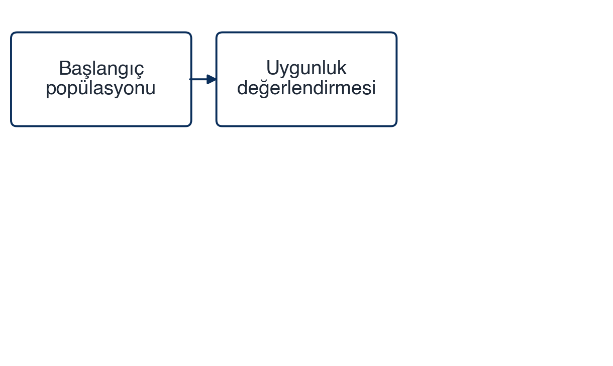
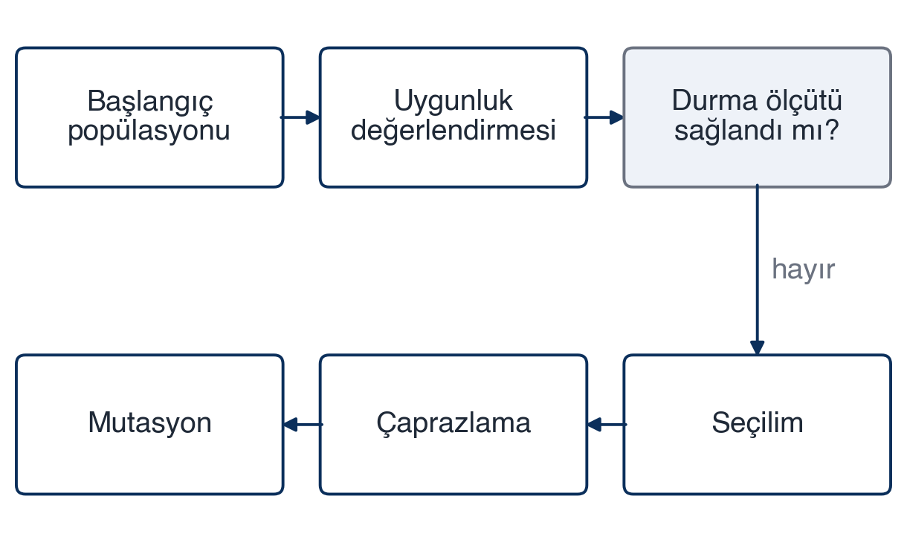
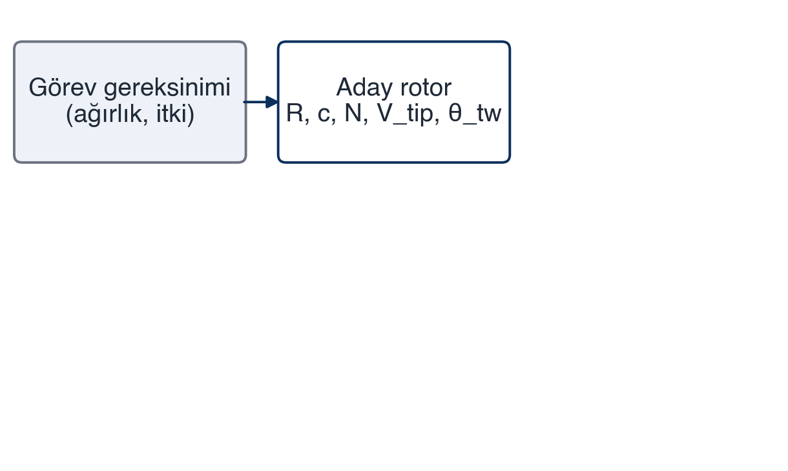
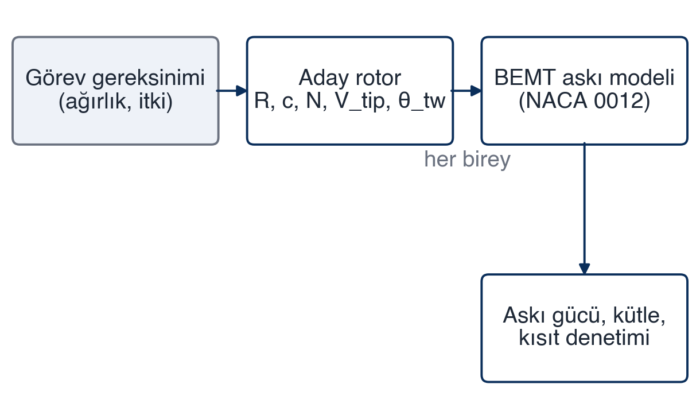
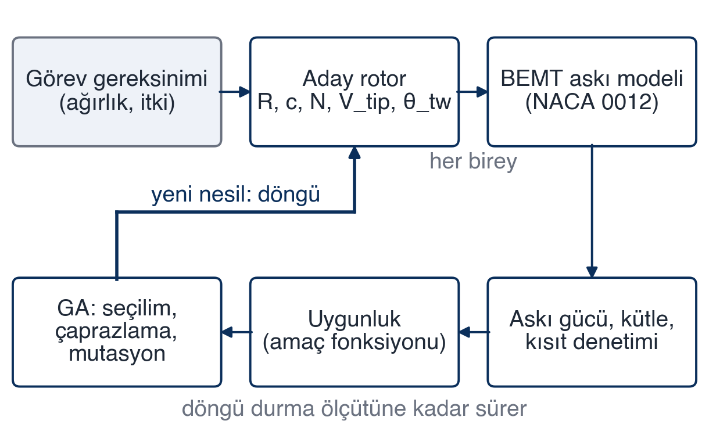

## [icindekiler] İçindekiler
- Giriş
- Literatür Taraması
- Araştırma Yöntemi
- Sonuçlar
- Soru-cevap

## [metin] 3 · Giriş: rotor konsept tasarımı neden zor
mesaj: Ana rotorun beş konsept değişkeni birbirine bağlıdır; biri değişince bütün hesap yenilenir.
- Ana rotor, helikopterin kaldırma kuvvetini üreten ve performansını belirleyen alt sistemdir
- Konsept aşamasında beş temel değişken: yarıçap, veter, pal sayısı, uç hızı, burulma
- Değişkenler birbirine bağlı: biri değişince askı gücü, kütle ve kısıtlar yeniden hesaplanır
- Bugünkü uygulama çoğunlukla deneyime dayalı ve iteratif [2], [3]
> Dinleyiciyi problemin içine sokan slayt. Rotor boyutlandırmasının neden tek adımda yapılamadığını, bir değişkenin diğerlerini nasıl etkilediğini bir örnekle anlat (ör. yarıçap büyüyünce askı gücü düşer ama kütle ve uç hızı kısıtı devreye girer). Geçiş: "Bu döngüyü elle değil sistematik olarak çevirebilir miyiz?"

## [metin] 3 · Giriş: araştırma sorusu
mesaj: BEMT askı modeli ile genetik algoritmayı birleştirip beş rotor değişkenini askı gücü ve kütleye göre en iyileyen bir yöntem geliştirmek.
Pal elemanı momentum teorisine (BEMT) dayalı bir askı performans modeli ile genetik algoritmayı birleştirerek, verilen görev gereksinimi için beş rotor konsept değişkenini askı gücü ve rotor kütlesi açısından en iyileyen bir yöntem geliştirmek.
- Tez başlığı: Genetik Algoritma Optimizasyonu ile Helikopter Rotor Konsept Tasarımı
- Danışman: Doç. Dr. Ayşe Kaya [kurgusal] · tez önerisi Mayıs 2026
- Kapsam bugün için askı uçuşu; ileri uçuş sonraki aşama
> Araştırma sorusunu tek cümleyle yüksek sesle söyle; dinleyen bu cümleyi aklında tutacak. Kapsamın askı ile sınırlı olduğunu kendin söyle, soru gelmeden. Geçiş: "Bu soru neden önemli?"

## [metin] 3 · Giriş: neden şimdi, neden burada
mesaj: Yerli helikopter programlarında konsept rotor boyutlandırması elle iterasyonla yapılıyor; sistematik tarama yok.
- Gökbey gibi yerli döner kanatlı programlarda konsept rotor boyutlandırması elle iterasyonla yapılıyor
- Görev gereksiniminden (azami ağırlık, itki ihtiyacı) rotor değişkenlerine sistematik tarama henüz yok
- Beklenen fayda: konsept döngüsünün kısalması; tasarım uzayının elle ulaşılmayan bölgeleri
- Süre kazancı henüz ölçülmedi; sayı vermiyorum
- Gizlilik: şirket verisi yok, doğrulama açık literatür rotoruyla (Westland Lynx) [4]
> iş yerindeki gözlemini kendi ağzından anlat ama ölçmediğin bir kazancı sayıyla söyleme. Açık veriyle doğrulama kararının hem etik hem pratik gerekçesini ver. Geçiş: "Önce literatürde ne var, ona bakalım."

## [surec] 4 · Literatür: klasik konsept boyutlandırma
mesaj: Klasik yaklaşım sıralı ve elle ilerler; tek bir tasarıma götürür, tasarım uzayını taramaz [2], [3].
- Disk yüklemesi seçilir (benzer helikopter istatistikleri)
- Yarıçap belirlenir
- Uç hızı seçilir (Mach ve gürültü sınırı)
- Katılık, veter ve pal sayısı
- Burulma ve profil: askı verim katsayısı (figure of merit) için ayar
> Hangi değişkenin hangi adımda sabitlendiğini göster; yöntem tek noktaya götürür, uzayı taramaz. Geçiş: "Bu yöntemin Lynx'e uygulanmış hâli var."

## [karsilastirma] 4 · Literatür: Lynx konsept çalışması
mesaj: Novak vd., Westland Lynx ana rotorunu klasik yöntemle yeniden boyutlandırır; bu tez için açık ve tam bir doğrulama referansıdır [4].
### Girdi ve yöntem
- Görev gereksinimi: ağırlık, irtifa, hız
- Adımlar elle, optimizasyon yok
- Tek tasarım, alternatif karşılaştırması yok
### Çıktı ve tez için anlamı
- Yarıçap, veter, pal sayısı, uç hızı, burulma
- Aynı girdilerle modelim Lynx değerlerine ne kadar yaklaşıyor?
- [ÖĞRENCİ TAMAMLAYACAK: Lynx rotor değerleri makaleden doğrulanıp tabloya eklenecek]
> Sayıları ezbere söyleme. Neden doğrulama referansı: açık, tam, aynı değişkenler.

## [metin_gorsel] 4 · Literatür: genetik algoritma nasıl işler
mesaj: Genetik algoritma aday tasarımları nesilden nesile iyileştirir; en iyiyi garanti etmez, iyiye hızlı yaklaşır [1].
- Her birey bir aday tasarım; uygunluğu amaç fonksiyonuyla ölçülür [1]
~~~
- Seçilim iyileri tutar, çaprazlama genleri karıştırır, mutasyon rastgele değiştirir [1]
~~~
- Döngü durma ölçütüne kadar sürer; küresel en iyi garanti edilmez [1]
- Çok değişkenli, türevsiz tasarım problemlerinde kullanılır [1], [5]

![Şekil 1. Genetik algoritma döngüsü. Katoch vd. [1] temel alınarak çizildi.](gorseller/ga_dongusu_3.png)
> Tıklamalı slayt: önce popülasyon ve uygunluk, sonra üç operatör, sonra döngü ve durma. Her adımı rotor örneğine bağla: bir birey = (R, c, N, V_tip, θ_tw) beşlisi. "En iyiyi garanti etmez" cümlesini kendin söyle. Geçiş: "Bu döngünün neyi arayacağını belirleyen şey değişken uzayı."

## [gorsel] 4 · Literatür: tasarım değişkenleri ve aralıklar
mesaj: Beş değişkenin aralıkları literatürden derlendi; pal profili NACA 0012 sabit tutuldu [2]–[4].
![Şekil 2. Beş tasarım değişkeni ve literatürden derlenen aralıkları; pal profili NACA 0012 sabit. Aralıklar Leishman [2], Johnson [3] ve Novak vd. [4] temel alınarak belirlendi.](gorseller/tasarim_degiskenleri.png)
> Her aralığın kaynağını söyle: yarıçap ve veter Lynx sınıfı helikopterlerden [3], [4]; pal sayısı ve uç hızı Leishman'daki tipik aralıklar [2]; burulma Leishman ve Johnson [2], [3]. Aralıkların "orta sınıf helikopter" için olduğunu, başka sınıfa taşınmayacağını belirt. Geçiş: "Peki bu iki bileşeni birleştiren çalışma var mı?"

## [karsilastirma] 4 · Literatür: araştırma boşluğu
mesaj: GA ile rotor optimizasyonu var; konsept aşamasında hızlı BEMT ile az değişkenli açık bir iş akışı sınırlı.
### Literatürde var
- GA ile rotor optimizasyonu, çoğu ayrıntılı tasarım aşamasında
- Çok değişkenli, ağır modellerle
- GA derlemeleri genel, rotor özelinde değil [1]
### Sınırlı ya da yok
- Konsept aşamasında hızlı BEMT + az değişkenli GA döngüsü
- Lynx gibi açık bir referansla doğrulanmış, paylaşılabilir iş akışı
- Tarama danışmanla genişletilecek; "yok" değil, "sınırlı"
> "Hangi veri tabanlarında, hangi anahtar kelimelerle aradınız?" sorusuna hazır ol.

## [metin_gorsel] 5 · Yöntem: BEMT–GA iş akışı
mesaj: Her aday rotor için BEMT modeli askı gücü ve kütleyi hesaplar; GA bu uygunlukla yeni nesli üretir.
- Görev gereksinimi → aday rotor (kromozom)
~~~
- BEMT askı modeli: askı gücü ve rotor kütlesi; kısıt denetimi
~~~
- Uygunluk → GA operatörleri → yeni nesil; döngü durma ölçütüne kadar
- Sonuç Lynx rotoruyla karşılaştırılır [4]

> Tıklamalı slayt: kutular üç adımda açılır. Her kutuda "bu hazır mı?" sorusunu cevapla: görev gereksinimi ve kromozom tanımı hazır, BEMT askı modeli çalışıyor, GA bağlantısı yok. Geçiş: "Döngünün kalbi BEMT modeli; ona bakalım."

## [metin_gorsel] 5 · Yöntem: BEMT askı modeli
mesaj: Askı modeli Python'da çalışıyor; ileri uçuş henüz yok.
- Momentum teorisi: askı itkisi indüklenmiş hızdan [2]
$$T = 2 \rho A v_i^2$$
- Pal elemanı teorisi: her kesitte dL, dD; çıktı askı itkisi ve gücü
- Varsayımlar: NACA 0012 sabit profil, doğrusal burulma, sıkıştırılamaz akış; ileri uçuş yok
![Şekil 4. Pal elemanı kesiti ve hız üçgeni. Leishman [2] temel alınarak nitel olarak çizildi.](gorseller/bemt_kesit.png)
> Şekli anlatırken hız üçgeninden hücum açısına, oradan dL ve dD'ye git. Varsayımları kendin say; "neden NACA 0012" sorusuna hazır ol (yaygın, verisi açık, konsept aşamasında yeterli). Kütle kestirim ilişkisinin henüz seçilmediğini açıkça söyle. Geçiş: "Modelin girdisi kromozom."

## [tablo] 5 · Yöntem: değişkenler ve kromozom
mesaj: Kromozom beş genden oluşur; her gen bir tasarım değişkeni, aralıklar kütüphane sınırlarıyla tutulur.
Gen | Değişken | Aralık | Tür | Aralığın kaynağı
R | Rotor yarıçapı | 5,5–7,0 m | sürekli | [3], [4]
c | Veter | 0,25–0,45 m | sürekli | [3], [4]
N | Pal sayısı | 2–5 | tam sayı | [2]
V_tip | Uç hızı | 190–220 m/s | sürekli | [2]
θ_tw | Burulma | −6 … −14° | sürekli | [2], [3]
Pal profili NACA 0012 sabit; gen değil.
> Tam sayı pal sayısının kodlamada ne gerektirdiğini söyle.

## [kartlar] 5 · Yöntem: amaç fonksiyonu ve kısıtlar
mesaj: Amaç askı gücü ve rotor kütlesi; üç kısıt görev ve fizikten gelir, biçim danışmanla belirlenecek.
### Amaç fonksiyonu
- Askı gücü ve rotor kütlesi
- Ağırlıklı tek fonksiyon ya da çok hedefli (Pareto)
- Biçimi danışmanla belirlenecek; ikisi de denenebilir
### Kısıt 1 · Uç Mach
- Uç hızı 190–220 m/s aralığı
- Dolaylı uç Mach sınırı
### Kısıt 2 · Pal yüklemesi
- Tutunma kaybına karşı üst sınır
- Planlanıyor, henüz yazılmadı
### Kısıt 3 · İtki ihtiyacı
- Görev ağırlığından gelir
- Gürültü modellenmiyor
> Dinleyiciden görüş iste: ağırlıklı toplam mı Pareto mu?

## [kartlar] 5 · Yöntem: GA ayarları ve kütüphane
mesaj: Hazır kütüphane kullanılacak; ayarlar denemeyle, tekrarlanabilirlik aynı tohumla sağlanacak.
### Kütüphane
- DEAP ya da pymoo
- Henüz denenmedi, karşılaştırılacak
- Çok hedefli seçilirse pymoo'daki uygun algoritma
### Ayarlar
- Popülasyon büyüklüğü, nesil sayısı
- Çaprazlama ve mutasyon oranları
- Denemeyle belirlenecek
### Hız ve tekrarlanabilirlik
- Her uygunluk hesabı bir BEMT çağrısı: model hızlı olmalı
- Aynı tohumla tekrarlanabilir koşular
> Seçim ölçütleri: karma değişken desteği, çok hedefli algoritma, belgeleme; birden çok koşu.

## [surec] 5 · Yöntem: doğrulama stratejisi
mesaj: Doğrulama iki adımda Lynx rotoruyla yapılır; deneysel veri yoktur, kabul ölçütü danışmanla belirlenecek [4].
### Adım 1 · Model
- BEMT askı modeli Lynx girdileriyle çalıştırılır
- Askı gücü literatür değeriyle karşılaştırılır
### Adım 2 · Optimizasyon
- GA, Lynx görev gereksinimiyle koşturulur
- Bulunan tasarım Lynx rotoruyla karşılaştırılır
### Sınır
- Deneysel veri yok
- Kabul ölçütü henüz belirlenmedi
> "Lynx'ten farklı sonuç yanlış mı?" sorusuna hazır ol: Lynx tek bir tasarımdır, fark yorumlanır.

## [zaman] 5 · Yöntem: şu anki durum ve takvim
mesaj: Literatür, değişkenler ve askı modeli tamam; GA bağlantısı ve Lynx doğrulaması sırada, ileri uçuş zaman kalırsa.
- Mayıs 2026 | Tez önerisi
- Eylül 2026 | Literatür, değişkenler ve aralıklar
- Kasım 2026 | BEMT askı modeli (Python) çalışıyor
- Aralık 2026 | Seminer
- Ocak–Şubat 2027 | GA bağlantısı, Lynx doğrulaması
- Bahar 2027 | İleri uçuş modeli (zaman kalırsa)
Sınırlılıklar: BEMT'in yüksek yüklemedeki sınırı; dinamik tutunma kaybı ve pal elastikliği yok; GA en iyiyi garanti etmez; yapısal analiz kapsam dışı.
> Takvimi ay ay söyle. Sınırlılıkları dinleyici bulmadan önce say.

## [kartlar] 8 · Sonuçlar: ne götürüyorsunuz
mesaj: Problem tanımlandı, tasarım uzayı kuruldu, yöntem planlandı; sıradaki adım GA bağlantısı ve Lynx doğrulaması.
### Problem
- Konsept rotor boyutlandırması elle ve iteratif
- Sistematik tarama yok
### Yöntem
- BEMT askı modeli + genetik algoritma
- Beş değişken, Lynx ile doğrulama
### Durum
- Model çalışıyor
- GA bağlanmadı, sayısal sonuç yok
### Sonraki adım
- GA bağlantısı ve Lynx doğrulaması
- Geri bildirim: amaç fonksiyonu ve kısıtlar
> Üç cümle; amaç fonksiyonu ve kısıtlar için görüş sorarak soru-cevaba geç.

## [tesekkur] Teşekkürler
Danışmanım Doç. Dr. Ayşe Kaya [kurgusal]'ya yönlendirmeleri için, iş yerimdeki çalışma arkadaşlarıma teşekkür ederim.

## [kaynaklar] Kaynaklar
[1] S. Katoch, S. S. Chauhan ve V. Kumar, "A review on genetic algorithm: past, present, and future," Multimedia Tools and Applications, c. 80, sayı 5, s. 8091–8126, 2021, doi: 10.1007/s11042-020-10139-6.
[2] J. G. Leishman, Principles of Helicopter Aerodynamics, 2. bas. Cambridge, U.K.: Cambridge Univ. Press, 2006.
[3] W. Johnson, Rotorcraft Aeromechanics. Cambridge, U.K.: Cambridge Univ. Press, 2013, doi: 10.1017/CBO9781139235655.
[4] D. Novak, T. Bucak ve A. Domitrović, "Helicopter main rotor conceptual design: application to a Westland Lynx helicopter," Promet – Traffic & Transportation, c. [DOĞRULANACAK], s. [DOĞRULANACAK], 2008.
[5] [DOĞRULANACAK: AHS Forum bildirisi, 2011].
Şekil 1–4: yazarın tarifiyle ve [1], [2] temel alınarak Claude ile çizildi; Şekil 2'deki aralıklar yazar tarafından belirlendi.
